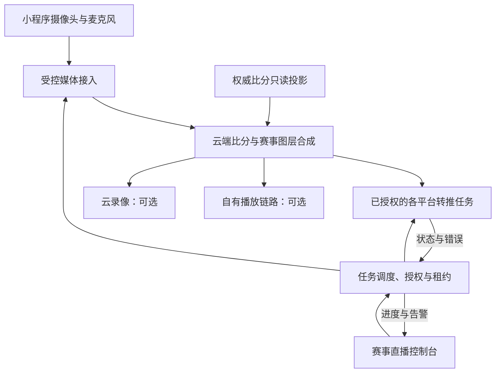

# 小程序直接开播与多平台分发设计

2026-10-31 Asia/Shanghai；DOC005；版本 v1；负责人及集成人 Codex root。

**DOC005原始交付性质为产品、交互与技术方案文档。后续E01/E02已增加采集、权威比分合成、独立转推/停流及整场媒体处理代码；当前合并和隔离证据见[八项总任务](../tasks/EXPANSION8.md)。** 正式平台准入、账号／同播权限、真实推流和官方微信／真机仍未验。本设计中的候选对象与接口以现行[API合同](../API_CONTRACTS.md)和[数据模型](../DATA_MODEL.md)为准，不能将原设计参数当已启用外部能力。

## 1. 用户目标与首版选择

用户要求：**手机打开“小城市篮球”微信小程序，直接使用摄像头和麦克风开直播，由云端把一路直播同时分发到多个已授权平台。** 主播正常开播操作集中在小程序内，电脑或OBS不是首版必经环节。

首选路径为“小程序单路采集上行 → 云端受控接入 → 云端比分合成 → 各目标平台独立转推”。第一版采用单手机、横屏、一场比赛一个任务、至少两个具备正式权限的目标渠道验证；选中的渠道预检通过后一起启动。1080p为目标档位，帧率、码率、编码、传输协议和降档规则以微信真机及所选供应商、目标平台实测为准，不承诺统一规格被所有平台接受。

首版包含比赛绑定、渠道选择、采集预览、开播预检、比分合成、分平台状态、独立停止／重连、异常恢复和用量记录。小程序内观看及云录像分别选配；未通过对应链路验收时仅提供已确认可用的外部观赛入口。多机位、横竖屏双输出、自动集锦、弹幕汇聚、平台观众数汇总、付费观看和OBS远控后置；不得用抓取或非官方协议补齐受限能力。

## 2. 与现有交付的关系

基线为 `main@3ccb4ff4282d7fba9c4ca251e66b141af32c97c1`。现有40条小程序路由、24个Migration及83张表不因本设计增加或改变。

- P06-A已交付透明比分网页与独立只读授权；网页层不是视频流，不能直接等同云端已把比分烧录进视频。合成厂商能否处理所需图层、比例和字体须验证；可复用字段白名单和渲染规则，不直接假定可加载现有网页。
- 现有记分服务是唯一比分和时钟权威，直播只读；直播故障不能阻断记分、确认或比赛进程。既有记分租约不能当直播设备租约。
- 既有媒体服务仅有受控小文件、受信外链、人工时间标记和发布／撤销。不能复用其外链字段让服务器任意抓流，也不扩大8MiB上传上限。
- 新目标替代旧文档中“必须先经OBS开播”的产品首选顺序；保留OBS浏览器源等已交付能力和历史验收。OBS可在后续作为另一类经授权的输入源。
- 现有OverlayGrant由赛事持有，签发者个人失权不自动撤销；新直播采集／运行授权独立建模，不能追溯改变旧Grant语义或默认沿用其生命周期。
- C23的本人照片、身份证、保单、宣传许可与直播音视频授权不同。私有报名材料不进入直播画面；照片宣传授权不自动成为赛事直播或录像授权。

## 3. 平台能力与启用门槛

以下均为实施前必须取得证据的条件，不是本轮已验证事实。

| 对象 | 必须核验 | 未满足时的产品行为 |
| --- | --- | --- |
| 微信小程序采集 | 当前主体、类目、直播推流组件／接口准入、摄像头麦克风与隐私要求、版本和设备、推流域名及协议 | 开播入口显示具体未就绪原因；不以普通相机预览或web-view替代正式推流验收 |
| 抖音 | 具体账号直播资格、第三方推流许可、参数获取方式／有效期、直播间地址及同播规则 | 渠道待核验或不支持，不可选为开播目标 |
| 视频号 | 同上，独立确认其官方能力与账号条件 | 不因同属微信就自动认定可转推 |
| 快手 | 同上 | 仅对已核验账号开放 |
| B站及后续平台 | 同上，逐个建立端点与状态能力清单 | 不使用“支持所有平台”的统一开关 |
| 云端接入与合成 | 小程序兼容、输入／输出协议、服务端认证、视频合成、状态事件、停流／过期能力、成本与数据地域 | 未选型或未验证时仅保存设计／任务草稿，不启动真实资源 |
| 小程序播放 | 自有合法播放源、域名、播放器准入、鉴权及内容发布条件 | 不承诺任意外部直播间可内嵌；按允许方式展示或跳转 |

首次关联账号或更新过期推流参数可能需按平台流程在外部完成。界面明确“已配置目标”“云端转推连接”“平台已开播”三者不同。平台只允许人工确认时记录确认人和时间，并标注“人工核对”；不能伪造官方状态。

## 4. 总体架构

控制API负责权限、期望状态和任务记录；媒体网关／转推执行器处理真实音视频。外部操作通过可恢复任务执行，不把云厂商网络调用伪装成数据库事务的一部分。供应商、基础设施和价格本轮不定购，不承诺现有低价业务服务器可承担合成和全国视频分发。

## 5. 页面与交互规格

沿用深蓝 `#123C73`、橙色 `#F28C28`；危险停播与普通切换分区。横屏直播以画面和采集状态优先，竖屏展示任务／配置。下面L01—L08是逻辑页面／状态设计，不代表已新增路由、Figma画板或效果图。

| 编号 | 界面 | 布局与操作 |
| --- | --- | --- |
| L01 | 我的直播任务 | 从“我的→工作人员工作台”或有权赛事／场次进入；按机构、赛事、比赛显示草稿、直播、部分异常、结束；普通观众只见观赛入口 |
| L02 | 开播设置 | 顶部显示赛事、场次、双方、场馆和预定时间；编辑标题／授权封面，勾选已验证渠道，选择合成模板；录像和自有播放单独开关并展示费用影响 |
| L03 | 摄像头预览 | 说明用途后申请必要权限；预览取景、切前后摄像头、麦克风开关和音量反馈、横屏提示、可用清晰度；拒绝后保留任务并提供恢复入口，不反复索权 |
| L04 | 开播预检 | 逐项展示权限、设备、入流、目标参数、比分源、发布批准和预算；阻塞项可定位处理；只对当前任务版本提供“开始直播” |
| L05 | 直播中 | 主画面、比赛与播出时长；源状态、比分新鲜度、各平台卡片及观测时间、网络和用量；支持单平台停止／重连、静音和结束全部；本地预览与云合成预览分开标注 |
| L06 | 中断与恢复 | 区分源断流、比分不可用、单目标失败、凭据过期、后台中断、租约被接管；给出当前事实、恢复动作和原操作核对，不用一个“重试”掩盖所有原因 |
| L07 | 结束与交付 | “结束直播”确认影响所有选中渠道；先显示停止处理中，全部停推可证实后再显示本系统已结束；外部直播间关闭与录像生成进度分别列出 |
| L08 | 观众直播页 | 真实赛事／场次、可用渠道、状态与最后核验时间；自有播放通过验收后才出现播放器；无画面保留比分／赛程入口，回放经审核发布后另列 |

直播设置或预览返回上页不等于服务端停播。离开正在采集的页面须提示，并提供明确“暂停并离开／结束直播”；系统退后台无法依靠弹窗确认，按第10节处理。摄像头翻转、麦克风关闭等效果须以组件及云端事实验证，不把按钮样式变化当成设备已生效。

## 6. 主播开播流程

1. 有权工作人员选定一场已正式发布、允许直播的比赛，创建草稿；多个球场并行比赛各用独立任务／源。
2. 为本场取得独立直播分发批准，核对赛事直播权利、公开内容、目标渠道和必要告知；选平台并确认当前费用估算与上限。批准人和直播执行人按赛事权限区分，STREAMER不因能管理媒体就自动获得对外发布权。
3. 预览摄像头和麦克风，选择模板；云端预检账号、目标端点、参数有效期、比分源、并发和用量限制。外部平台要求的必要开播确认另行完成。
4. 点击开始前持久化本次操作编号和任务版本。服务端锁定任务、源代次及目标配置，取得单设备采集租约，发放本场短期入流凭据；手机仅推到本系统受控接入点。
5. 云端实际收到合法音视频后启动／确认合成及各目标任务。分别反馈进度；受理成功、手机组件回调和本地预览都不能代替云端入流成功。
6. 两个目标只有一个连通时显示“部分渠道已连接”及逐项结果，允许继续已授权的成功渠道或结束；不自动改投其他账号。观众入口仅发布已核验可用渠道。
7. 开播中持续检查运行授权、源租约、目标状态、媒体健康和预算。比分由独立只读流进入云合成，直播员不得改比分。
8. 结束时先保存不可复活的停止意图，撤销入流凭据，再对合成、各目标、自有播放和录像执行停止／封存；结果未知显示待确认并持续对账，不能让用户因丢响应再次创建直播。

## 7. 权限、发布与账号边界

- 权限按机构、赛事、比赛、操作及有效期判断；OWNER／ADMIN或本赛事有权负责人管理批准和目标关联，分配的直播人员执行其任务。具体API授权先与现有角色矩阵做差异审查，不能临时扩大既有STREAMER媒体发布能力。
- 目标账号归属、授权使用范围及密钥维护人员明确；知道直播间地址不构成推流授权，拥有某城市权限不授跨机构账号权限。
- 新直播分发批准、自有播放发布、公开目录／观赛链接、旧OverlayGrant和录像发布是独立资源。撤销直播分发批准须停止相关源和所有目标；单独撤销某目标只停止该目标。
- 关闭现有观赛链接或退出公开目录不等于已停止外部直播：管理界面必须明确显示仍有独立直播批准，并提供单独“结束直播／撤销分发批准”；用户明确选择联动撤销时执行级联。不能把一个旧目录开关偷偷解释成云端停播成功。
- 直播人员被撤权或采集设备被接管后，其旧设备凭据失效；同一任务若无另一名当前有权人员完成显式接管，暂停分发。机构停用、直播批准过期／撤销或明确结束均触发停止；管理员主动结束不受原主播在线状态限制。
- 直播画面、赛事标识、队徽、赞助及人像素材分别核对使用权。证件、保单、联系方式、工作人员私有名单和C23私有照片原图不进入合成、观众DTO、字幕或日志。

## 8. 状态与事实来源

| 对象 | 设计状态／字段 | 判定依据 |
| --- | --- | --- |
| 任务控制意图 | DRAFT、RUNNING、PAUSED、STOPPED；version、generation | 服务端持久记录；STOPPED为终态，重开新任务身份 |
| 实际会话 | PRECHECK、STARTING、LIVE、PARTIAL、INTERRUPTED、STOPPING、ENDED、FAILED | 由当前代次的源、合成和目标事实聚合；控制意图与观测状态分开 |
| 手机源／云入流 | IDLE、CONNECTING、INGESTING、INTERRUPTED、REVOKED；sourceEpoch、fence、lastFrameAt | 手机状态与云端有效入流分别记录，不相互冒充 |
| 目标转推 | UNVERIFIED、READY、STARTING、CONNECTED、RETRYING、FAILED、STOPPING、STOPPED、UNKNOWN；另存desiredState、targetEpoch和配置版本 | 当前尝试的厂商事件或核对结果，带observedAt、attempt和错误类型；不能由观测反写启动意图 |
| 外站开播 | UNKNOWN、CONFIRMED_LIVE、CONFIRMED_ENDED；证据来源与时间 | 官方能力可核实时用官方事实，否则人工核对并标来源；CONNECTED不等于外站开播 |
| 比分合成 | STARTING、HEALTHY、STALE、FAILED、STOPPED | 机器只读授权、模板版本、快照版本、时间锚点和健康状态 |
| 录像 | OFF、STARTING、RECORDING、FINALIZING、READY、FAILED | 独立录制会话和产物校验，READY也不自动公开 |

UI必须显示最后观测时间和未知状态；控制服务失联时保留真实已知状态并标陈旧，不能继续展示无条件绿色“直播正常”。停止外部推流连接与关闭外站直播间不同；厂商或平台无法确认关闭时显示“本系统停推已确认，外站结束待核验”，不得伪造同步结束。

## 9. 幂等、并发与终止

所有写命令采用本地先保存的UUID操作编号、规范化请求指纹和expectedVersion；同编号同参数查原回执，同编号异参数拒绝。结果未知先查询原操作，不能自动换编号再开流、重复计费。账号切换、页面卸载及晚到响应须用账号／页面代次阻止污染当前页面。

每场首版最多一个活动主直播任务；同一入流源只允许一个当前采集设备租约。新设备显式接管须重新授权、推进fence并撤销旧凭据，旧心跳不能踢走新设备。媒体调度worker租约与手机源、记分租约分别管理，僵尸worker不得继续创建或重连目标。

另按厂商已核验的“外部账号身份＋直播间／推流槽位”原子预约目标资源并检查并发上限；未知默认不允许同槽多流，不能让两场比赛互相顶流或串场。账号身份与槽位由经验证的服务端映射确定，不能让客户端换一个accountId就绕过占用；跨机构共享须另有明确授权。旧目标停推UNKNOWN／STOPPING时保留占用，实际确认停止后才释放；不同场的独立任务不意味着可无约束共用同一外站账号／直播间。

每个目标同时持久desiredState、targetEpoch及配置版本。单目标停止先保存停止意图并推进屏障，旧attempt／配置的重试和回调不得重启；用户显式重连须重查任务RUNNING、直播批准、目标权限／凭据、预算和槽位，确认旧输出已停止后开启新epoch／attempt。后台中断、无帧超时或源失租时先持久PAUSED并使当前源／目标执行代次失效，再发停止外部输出；用户明确恢复、重新核验授权／预算／占用并推进新代次前禁止worker自动起流。旧epoch停止结果仅更新其清理事实，不能覆盖当前epoch状态。

采用事务内记录意图与outbox、事务外调用厂商、inbox验证去重和reconciler核对的方向。厂商操作键绑定任务／目标／代次；异步事件校验签名、来源、时间、目标归属和代次，允许乱序但不能回退终态。无法取得原创建结果时显示UNKNOWN并查原操作，不能盲目补建第二个收费资源。

停止命令先持久STOPPED和终止代次，再撤销手机源、停止全部目标／合成／播放、封存录像。停播期间到达的START成功、LIVE回调和重连一律不能复活任务；外部停止未确认则保持STOPPING／UNKNOWN并告警。厂商侧最大存续时间／停流兜底和人工处置通道必须选型验证，不能把本地任务终态等同云端已释放资源。

## 10. 手机中断、重连与切场

首版按**前台持续采集**设计，不承诺切微信聊天、退后台、锁屏或来电后仍可直播。摄像头／麦克风拒绝、系统打断、切网、弱网、过热和应用关闭分别提示，不能用“网络问题”一概归因。

- 页面得知退后台时请求暂停并停止分发；不能仅依赖onHide／onUnload成功发送。服务端另以源租约及真实音视频健康检查兜底。
- 产品初始参数候选：10秒心跳、30秒源租约、连续10秒无有效音视频标中断并请求停推；目标自动重试最多3次并退避。这些是待真机和厂商演练调整的设计值，不是官方限制或已验证SLA。没有持续有效画面时不无限转推最后一帧，也不自动循环广告继续计费。
- 已暂停时回前台须读取服务器意图、当前有权身份、租约与源代次，用户明确恢复后申请新短期凭据；未经授权、已STOPPED或已撤销不得自动重连。
- 同一未终止任务恢复但源重建／PTS重置时，新建SourceSegment和媒体锚点；超出当前授权期限、明确结束后重开、或切换正式比赛均新建任务身份。
- 切场先处理旧任务停推，再校验新比赛、比分源、批准和目标参数；旧场停止未确认时禁止静默切换为新场，不得出现新摄像画面叠旧比分。无法确认外部停止先走人工处置，不强行释放同场活动约束。
- 多场并行不共享采集租约或比分身份；首版不做一台手机同时采集多场。网络测速／预检只代表当时观测，不能承诺整场带宽。

## 11. 比分合成与时间对齐

云端合成应把队名、比分、节次、权威时钟和经批准的赛事图层真正写入输出视频，小程序界面覆盖一层文字不算多平台比分合成。首版统一横屏模板；竖屏应另做模板和安全区验收，不直接拉伸。

机器端使用专门、短期、限当前比赛与字段的只读身份，不携带工作人员Cookie、记分权限或任意机构查询能力。复用权威快照和模板规则，不直接复用旧OBS fragment／HttpOnly Cookie流程作为新机器凭据。

保留matchVersion、clockVersion、serverTime、源段PTS及接入／合成延迟锚点，明确哪些时间来自真实捕获能力、哪些仅是接收时间。入库时间或云接收时刻不能冒充手机拍摄时刻；供应商无法提供可靠锚点时需实测人工延迟校准并标误差，不承诺逐帧同步。时钟仅从权威锚点推算一次，不对已推算倒计时再次扣时。

比分失联立即标陈旧，首版设计最多保留30秒并显示“比分更新中”，超出则移除比分层、视频在有效直播批准下继续；授权失效立即请求清除受保护图层及必要的停推，不套用30秒数据容忍期。此阈值须云合成实测，不能拿既有网页源的通过结果替代；已送到外站的画面或CDN缓冲无法承诺追回。数据恢复先取当前完整快照及新锚点，不回放旧事件或把比分清零。

赛果更正保留版本关系，但不能倒改已播出或已下载的视频；录像事件定位跨源分段校准，离线补录不能直接按写入时间自动剪辑。云合成故障首版停止输出并告警，不在未经确认的情况下旁路到可能含旧图层的流。

## 12. 凭据、出网与安全

- 外部平台的推流密钥／授权令牌使用密钥托管或认证加密保存，只在有权服务器和厂商操作中使用；不能只存hash后又假装可恢复调用。客户端永不获取外部目标推流密钥。
- 手机获得的是本系统短期入流凭据，限定任务、源代次、有效期和接入点；并非所有推流凭据都能“仅在服务端”，客户端所需这一类必须与外部平台密钥分开。过期／接管／停播后旧源应被网关实际拒绝。
- 凭据轮换有版本和撤旧操作；展示仅脱敏。日志、审计、错误、截图、监控和导出都过滤URL路径与查询中的密钥；公开DTO不含内网地址或厂商写凭据。
- 外部转推新增服务器出网面，必须逐平台使用已核验的协议、端点模板和端口白名单；禁止用户任填任意RTMP／RTMPS／SRT目标。保存及连接时检查全部DNS解析结果、IPv4／IPv6及每次重解析，拒绝loopback、私网、链路本地、元数据地址、地址伪装和未经核验跳转，并用执行器出网限制兜底。
- 新出网校验独立设计，不能把现有媒体EXTERNAL_LINK的HTTPS主机检查当已覆盖直播转推。厂商事件需验签／防重放／去重；厂商操作和停止必须有超时、并发、目标数及资源时长上限。
- 合成模板首版固定，素材仅引用已批准、归属正确的资源ID及受控短期地址；不能让主播上传任意HTML、脚本或远程素材URL交给云端执行／抓取，素材取回也要遵守受控出网与访问期限。
- 公开观看采用独立发布／撤销和必要短期播放鉴权；关闭直播入口不等于删除录像，停播也不自动发布录像。跨机构不可因知道任务ID或账号ID取得状态、画面或费用详情。

## 13. 录像、回放和交付

手机本地预览不保证本地录像或系统退出后保留。云录像需单独选择并检查供应商、授权和预算，默认关闭；首版真实同播验收可在不购买云录像的情况下完成。

录制开始、正在录制、合并封存、产物就绪、失败分别显示；断流分段和缺口可见。录像完成后经有权人员检查关联比赛、授权、内容及版本，再走独立审核发布，不能绕过现有媒体发布权限或直接改小视频文件类型支持大视频。

录像保存期限、删除期限、争议留存、厂商删除凭证和成本须在启用前配置；未配置不得开启云录像。撤销公开回放后新访问失效，平台可控缓存与派生文件需处理；第三方录屏、转发和已下载内容不能保证追回。自动集锦和下载交付另立任务，不能仅因直播成功就显示“集锦已生成”。

## 14. 用量与成本

分别计量接入、合成计算、各目标出口、云录像、存储、转码和自有播放CDN；手机只传一路不代表总成本只算一路。失败重试、停流待确认和录像封存也可能产生费用，估算与厂商实际账单分开显示。

开播前设置允许的目标数、最大时长、并发、估算费用和预算阈值；运行中预警、禁止新增目标或按配置停止全部输出。账单延迟时不能承诺精确实时硬封顶；需要保守预留、供应商配额／最长存续限制及人工关停能力，未具备可接受止损条件不开真实流。账单晚到、重复和更正通过唯一计量来源及追加调整处理，不覆盖历史。

软件套餐费、视频用量及第三方平台收入分别展示；本轮不新增付款、钱包、分账、套餐收费或自动扣费。首次两平台验证先做受控时长的小范围测试，再测真实整场成本，不虚构固定月费或现有服务器预算足够。

## 15. 数据与接口方向（候选，未定稿）

| 候选对象 | 责任与必要约束 |
| --- | --- |
| BroadcastSession／LiveApproval | 机构／赛事／比赛、当前意图／状态／版本、批准范围、终止代次、预算；首版同场活动任务唯一 |
| LiveSourceLease／SourceSegment | 用户、设备、租约截止、fence、sourceEpoch、短期凭据引用、PTS重置及时间锚点 |
| ChannelAccount／TargetRelay／TargetSlotClaim | 账号归属／能力核验证据、secret引用与版本；核验账号和房间／槽位的原子占用；目标配置快照、targetEpoch、尝试号、期望与观测状态／时间 |
| CompositionSession | 模板、权威数据只读授权、匹配与时钟版本、图层健康、输入段与延迟校准 |
| RecordingSession／PlaybackPublication | 独立录制状态、分段与产物、留存、发布／撤销与内容审核 |
| LiveCommandReceipt／Outbox／Inbox | 请求指纹、原结果、外部操作键、可恢复调度、验签去重和终态防复活 |
| LiveUsageLedger | 来源和计量单位、唯一幂等键、估算／实际账单／追加调整，不写敏感密钥 |

候选API能力为：列可操作场次与能力、创建／读取任务、维护目标账号引用、预检、开始、查原操作回执、源租约心跳／显式恢复／接管、单目标停止／重连、暂停／结束、只读状态／用量、独立观众入口和供应商事件接收。具体路径、枚举、DTO、鉴权、错误码、锁序和Schema需实施前与现有合同差异审查后定稿，本轮不往API_CONTRACTS、DATA_MODEL或Migration写成已实现。

## 16. 分期与开工门槛

| 阶段 | 交付与退出条件 |
| --- | --- |
| A 能力验证 | 真实小程序主体／类目与接口准入、至少两个目标账号正式权限和同播规则、云厂商合成／停推能力及费用依据；缺项记明原因，不开发绕过方式 |
| B 规则与交互定稿 | L01—L08可编辑交互稿、授权／状态／终止／费用策略、字段白名单和接口／数据差异审查 |
| C 最小实现与隔离测试 | 单手机一场两平台、权威比分、独立目标恢复、幂等／租约／撤权／未知结果、安全出网、可观测用量；模拟厂商只验内部逻辑 |
| D 真实端到端验收 | 微信iOS／Android真机＋两家外站实际播放＋故障注入＋云端停止证据和真实账单；通过后才标可用 |
| E 扩展 | 逐个平台新增；自有播放器、云录像、双比例、多机位和集锦各有独立授权、成本与验收，不因首版通过一起开放 |

DOC005完成只代表设计文档交付。现有普通开发／Git授权不等于本轮授权采购云服务、配置新外部凭据、真实开播、收费或部署；后续按当时实际任务范围核验，不重复索要已有授权，也不凭本文计划自行开启付费资源。

## 17. 待实施验收清单

以下V01—V20全部为验收计划，本轮未执行。

| 编号 | 场景 | 通过要求 |
| --- | --- | --- |
| V01 | 准入或平台权限未知／不支持 | 禁止真实开播并定位原因，不承诺所有平台可用 |
| V02 | 微信真机采集与权限 | iOS／Android摄像头、麦克风、横屏及实际入流有效；拒绝与恢复不反复索权 |
| V03 | 两平台同时直播 | 同场同源真实推流，两外站实际播放核验，比分确在输出视频中 |
| V04 | 部分目标失败 | 成功渠道继续，失败独立恢复，聚合为部分成功，无自动错投账号 |
| V05 | 回调状态真实性 | 本地预览／连接成功不冒充外站已播；人工与官方证据来源清楚 |
| V06 | 退后台／锁屏／来电／切网 | 运行策略与真实设备相符，云端无帧／租约超时止损，暂停屏障拦旧重试，显式恢复先读服务端意图 |
| V07 | 设备／目标账号槽位并发及僵尸worker | 当前fence唯一；两场争同外站槽位原子拒绝，停止未知不释放；旧设备／执行器不能继续推流或重连 |
| V08 | 开播请求丢响应 | 原编号查询，无第二个收费任务；同ID异参数拒绝 |
| V09 | 全部／单目标停播与迟到START／LIVE | 意图及targetEpoch拦旧重试回调，终态不复活；显式重连先核实旧输出停止，真实云资源可核对，未知待确认 |
| V10 | 撤权与机构停用 | 按第7节范围级联，目标撤销只影响对应目标，隐私图层不沿用数据宽限 |
| V11 | 切场与源PTS重置 | 新任务或新段正确，不能新画面叠旧比分，锚点误差可解释 |
| V12 | 时钟／比分延迟和更正 | 权威时钟不重复扣时、陈旧按策略清层、恢复完整快照、不倒改已播录像 |
| V13 | 账号切换与页面迟到响应 | 旧私有画面／凭据不泄露，不误操作新账号任务 |
| V14 | 密钥和只读边界 | 手机仅本场短期入流凭据，外部密钥不进日志／URL导出／观众页，直播身份不可写比分 |
| V15 | SSRF与服务器出网 | 恶意协议／地址／端口／DNS重绑定／IPv6／跳转／内网目标均被拒绝 |
| V16 | 跨机构与资源猜测 | 无权状态、源、目标账号、画面、用量和产物均不可读取或修改 |
| V17 | 成本与重复账单 | 分目标计量、失败费用可见、超额止损可验证、唯一来源不重复累计 |
| V18 | 录制失败与回放发布 | 直播与录制独立，缺口可见、产物校验、审核后发布／撤销和到期删除 |
| V19 | 观众播放和渠道入口 | 实际允许的跳转／内播逐项验证；无画面仍可看比分，不构造假入口 |
| V20 | 整场与恢复演练 | 真实赛事时长、温度／电量／网络、停止未知人工处置、厂商账单和自有资源清理有证据 |

## 18. 官方资料与未核验项

本轮尝试官方定向网络检索，检索工具返回错误，未获得可引用原文；此前读取微信组件页得到不可用页面、云直播门户未取得正文。下列为后续必须核验的官方入口，不是本次已证实的能力或准入依据：

- [微信小程序 live-pusher 组件](https://developers.weixin.qq.com/miniprogram/dev/component/live-pusher.html)：需核验当前主体类目、组件能力、隐私与真机限制。
- [腾讯云云直播文档入口](https://cloud.tencent.com/document/product/267)：作为候选选型资料，接入／合成／第三方转推／状态／停流和费用需逐页实读与验证，不表示已选购腾讯云。
- 抖音、视频号、快手、B站：实际账号的官方创作者／直播控制台及官方规则为准；本轮未取得这些账号权限、推流参数、最新同播规则或接口许可。

实施前保存“平台＋账号范围＋能力＋官方依据／控制台证据＋核验日期＋有效期＋核验人”清单。技术方案是本项目选择，不把未读网页、第三方插件、概念图或既有CI当成真实开播依据。
