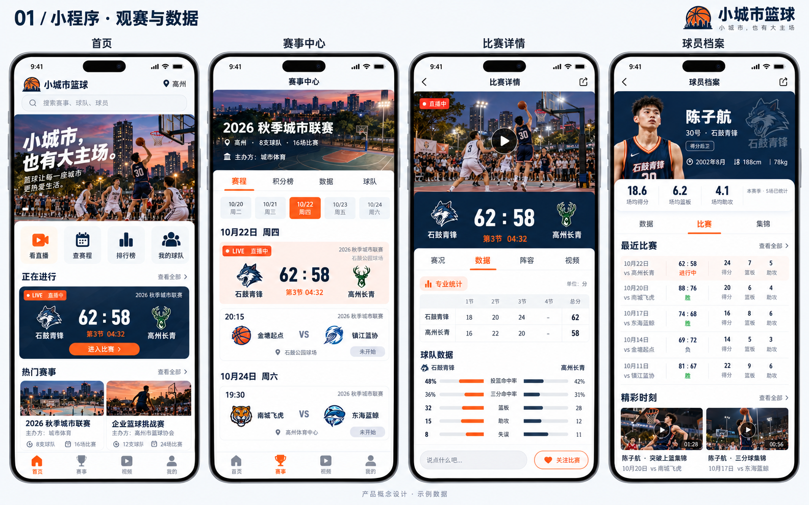
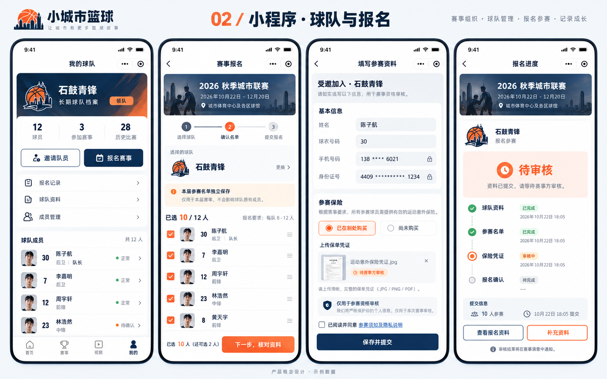
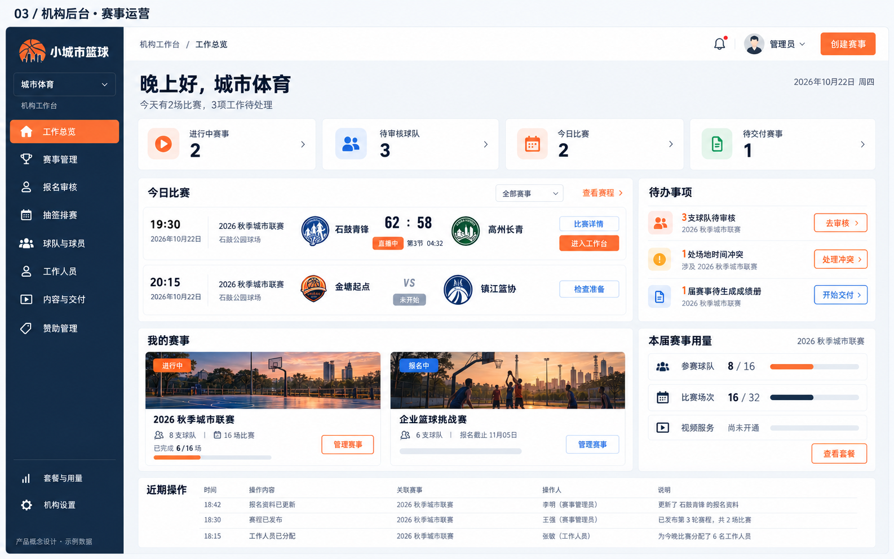
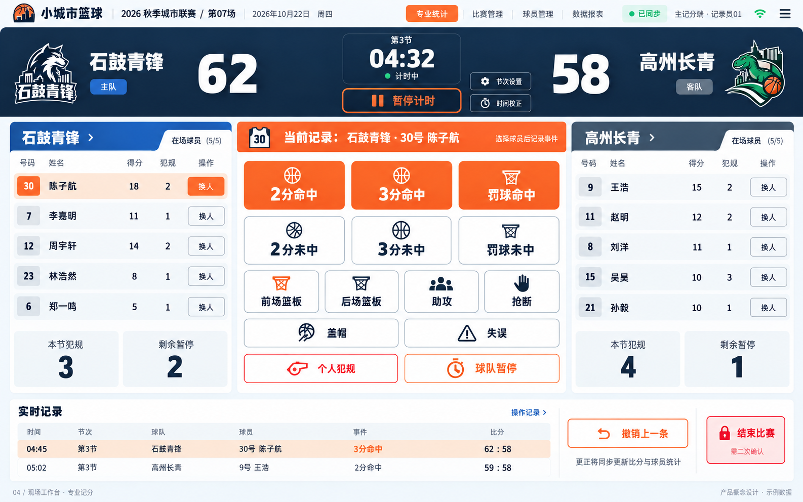

# 首版 UI 概念设计

日期：2026-10-22。

视觉方向：深蓝 `#132C49`、活力橙 `#FF6B2D`、浅灰背景 `#F5F7FA`。

这些图片用于确认产品方向，采用示例数据，不是已部署页面或最终交互规范。P01、P02、P03-A、P04-A已交付可运行Web/API代码，其中P03-A包含球队、领队授权、报名审核与冻结，P04-A新增共享场地、单循环手工排时和一次正式发布；这些成果不表示概念图里的小程序、保险上传或直播已完成。实际界面与范围以[UI规范](../UI_SPEC.md)及[当前状态](../CURRENT_STATUS.md)为准，各图队徽和示例数据不能当成业务事实。

## 01 小程序：观赛与数据

首页、赛事中心、比赛详情和球员档案。

## 02 小程序：球队与报名

小程序概念规划：球队管理、赛事报名、球员资料及审核进度，包括未来外购保险凭证上传。P03-A已实现对应的部分Web流程，尚无保险文件或微信接入，不能将此图视为已交付小程序。

## 03 机构后台：赛事运营

概念展示多赛事、待办、今日比赛、套餐及交付入口。真实Web已具备赛事草稿、球队、报名审核／冻结，以及2–32队单循环生成、共享场地和时间安排、冲突定位、确认发布与只读历史。当前不支持分组／淘汰、自动优化或发布后改期；套餐、赞助和赛后交付仍为规划，示例比分不是已接通记分服务。

P04-A实际界面记录见[草稿与正式赛程视觉证据](../evidence/P04-A/README.md)，维持深蓝／橙色风格及桌面、390宽度可用性。这些截图使用合成HTTP数据；真实业务验收另见[P04-A任务](../tasks/P04-A.md)和[CI39737812114](https://github.com/xyq-dev/small-city-basketball/actions/runs/39737812114)。没有生产部署，正式记分、赛果及OBS尚未实现。

## 04 现场工作台：专业记分

比分、计时、球员事件、撤销及同步状态；专业统计分阶段实施。

## OBS 后续界面

新增直播工作台，覆盖比赛绑定、只读包装地址、画面预览、比分与名单模板、冠名和赞助展示、推流配置及状态。当前尚未绘制该页面，也未实现接入。
