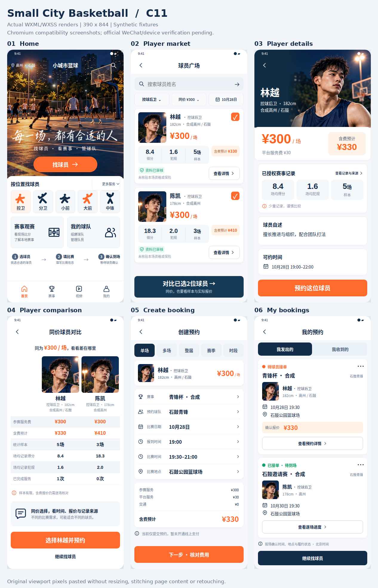

# C11 用户确认六屏实现与实际截图

2026-10-25；本轮六条核心路由已按用户确认的新图实现，用户视觉签收、官方微信开发工具和真机验收待办。

六屏依次为首页、球员广场、球员详情、同价球员对比、创建预约、我的预约。唯一视觉基准为[用户确认六屏图](../../design/C11/approved-six-screen.png)，原图SHA及归一裁图见[source.json](../../design/C11/source.json)。其余15页沿用C10设计，列入本轮全21页回归。

## 截图与来源

- 最终源码 `1d038743907d7357fb5035e1853520e20037ecf6`，完整tree `0bbe49846ea4cd7ca25a43188ff48c2c2acc3322`，apps subtree `ca1a23283c58aa33b8946147f18bc0dbce19c515`。
- [PR18](https://github.com/xyq-dev/small-city-basketball/pull/18)；[最终候选CI40170353262](https://github.com/xyq-dev/small-city-basketball/actions/runs/40170353262)，artifact `12589138818`，原始ZIP 126885262 bytes，SHA256 `b5847473d983ffa5877da44e4ebc5e962d422c8d7be4d3ff193bb12c3716a409`。已实际下载并核对大小、摘要、ZIP完整性和678原始布局JSON。
- [actual-six.json](actual-six.json)记录六张原始390×844首屏及哈希。拼图直接粘贴原始像素，未缩放、修饰或重绘页面；[normal-390](normal-390)保留六张原件。
- 完整验收包保留448张原始PNG、678份三宽JSON、116份滚动索引及21张参考图，226个场景，320/390/430三宽。390长页以原始844px视口分段保存，不拼接长图；非主态320/430 PNG不纳入精简包，原始artifact仍保留。

## 已做检查

289项原生Page/组件回归；1046项Web/API源码测试；typecheck、format、build；678组原生模板三宽布局及14项Web浏览器检查均通过。每页保留44px触控、字段可读和无横向溢出守卫；六页新增自定义头、12px间距、卡片/按钮几何、照片成功加载与裁切、标签和菜单单行断言。

三轮实际看图修正了详情切头和硬拼接、320对比文字折行、首页按钮文字颜色、预约主按钮位置、订单底部提示及更多符号。root查看最终六屏，两位域作者定向复核最终人像三宽及订单320/390，均无新增确定视觉问题；这不替代用户视觉签收。

运行时使用真实WXML/WXSS控件，未用页面截图替代界面。照片只在明确合成fixture中注入；真实目录缺少公开头像字段时显示中性占位，不把合成人物分配给真实球员。未采集统计、费用来源、五种预约、多人/条件意向、编辑草稿、声明默认未选、写锁和原请求编号恢复保留。

## 验收边界

这些是离线Chromium对实际原生模板的兼容渲染，并非微信运行时截图；系统胶囊、状态栏、字体及动态数据可能与图稿有差异。官方微信编译、真实AppID/合法域名、真机和用户视觉签收仍待。本轮无后端、API、DB/Migration、新依赖、生产部署或真实资金操作。

## Git与完整候选CI

CI40170353262三个job全部SUCCESS、attempt1、无重试；原始日志已读取。api真实PG集成/实际重启及desktop12/mobile12浏览器、正常/故意失败owned数据库清理通过；隔离production完整65表恢复/TLS/4浏览器通过。前两轮不是本轮完整通过证据。

PR18已合并main `ee359af9447fc1a71295b3f2c87d2f714766abeb`，合并完整tree/apps与上述最终候选完全一致，已实际fetch核验。[provider-verification.json](provider-verification.json)保留提供方与下载核验摘要；合并后独立重复CI未计作已完成。证据同步仅文档/原图/哈希及打包参考图来源标签修正，应用内容不变。

## 下载验收包

[small-city-basketball-c11-ui.zip](https://chatgpt.com/library?file_id=libfile_6021094c08fc81919482074fcab8bcb0&account_id=personal)，33210373 bytes（约31.7MiB）；SHA256 `c771becd5573227eb819edebf16ffa375921bce072dc34b1d2cb4b4ebac5b840`。已完成ZIP完整性、1274文件（1273份逐文件摘要，manifest自身除外）和HTML内部链接检查。解压后打开index.html；候选CI与下载/原图来源见包内provider-verification.json和manifest.json。
