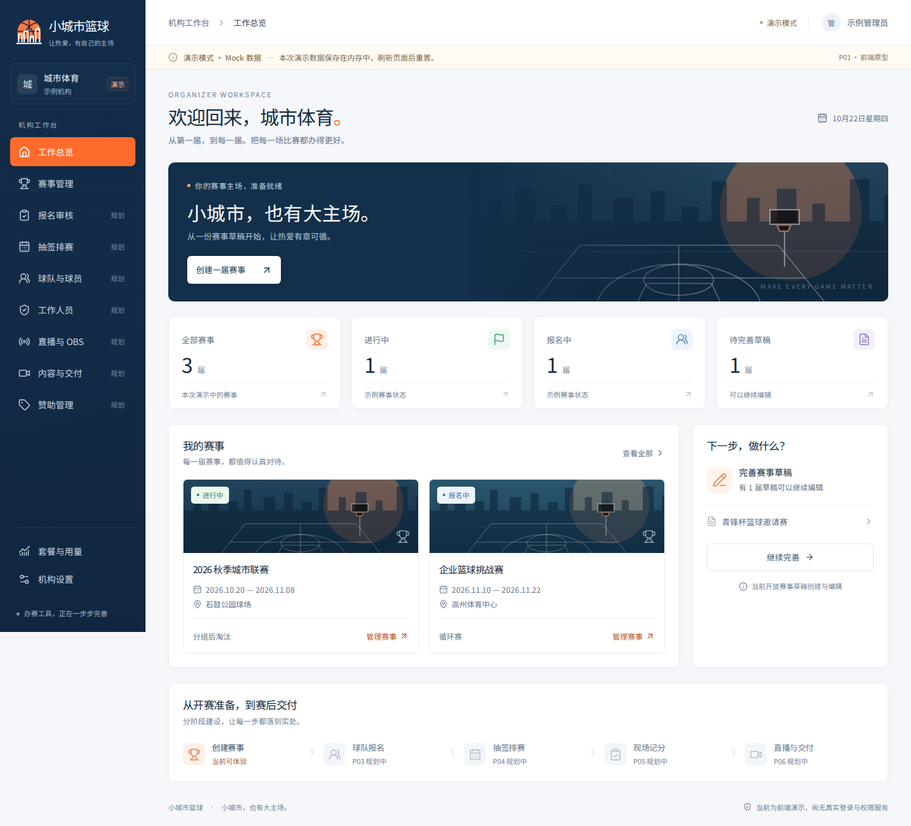
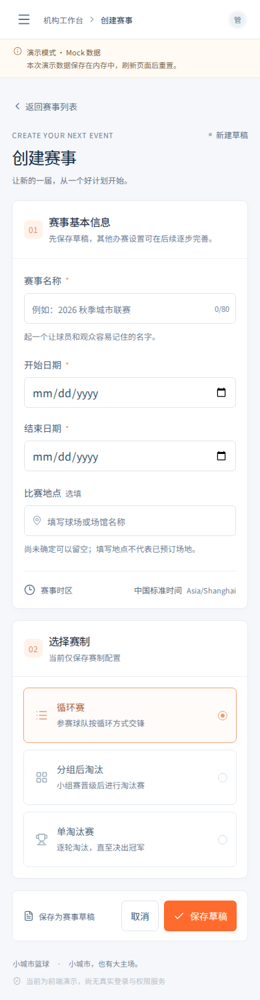

# P01 本地验收证据

日期：2026-10-22（Asia/Shanghai）。状态 REVIEW / LOCAL_ONLY。代码基线及当前未提交分支 HEAD：`daea629079bfabc5e77407ae58b50b4af01c1e20`，分支 `feat/P01-organizer-console`。业务代码尚未同步至 main，本文只共享已执行检查与截图。

## 可恢复依据

[source-manifest.json](source-manifest.json)逐文件记录本次实现的SHA-256，共22个源文件/配置/锁文件。总指纹为按路径排序的 `<文件SHA-256>  <相对路径>\n` 内容的SHA-256；该指纹定位未提交工作区，不能替代Git提交或备份业务源码。

## 实际验证

- `npm ci`、`npm run format:check`、`npm run typecheck`、`npm run build`：通过。
- `npm test`：35/35通过，含独立审查发现的两个继承属性路径回归。最终路由修复后重跑格式、类型和构建；原12项E2E检查仍对应相同四页及交互逻辑，未为此无关路由修复重复执行。
- Playwright1.62.1，Chromium153.0.8010.0：12/12 E2E通过；桌面与手机模拟各6项，手机不是Safari/微信真机。
- 四页各检查1440、1024、390宽度，共12视图：无横向溢出或运行错误，主要按钮不低于44px。
- CI未远端运行；未验证真实认证/数据库/OBS、生产路由、真机及付费服务。

完整命令、浏览器下载替代的环境限制、检查范围及接续步骤见[交接记录](../../handoffs/P01.md)和[开发说明](../../DEVELOPMENT.md)。

## 应用实拍

以下是运行中的本地原型，不是概念图。使用合成演示资料；内存数据刷新重置。QA截图为解决容器缺字临时注入本地中文字库，产品仍采用系统字体。

桌面工作总览，1440px：

手机创建赛事，390px：

