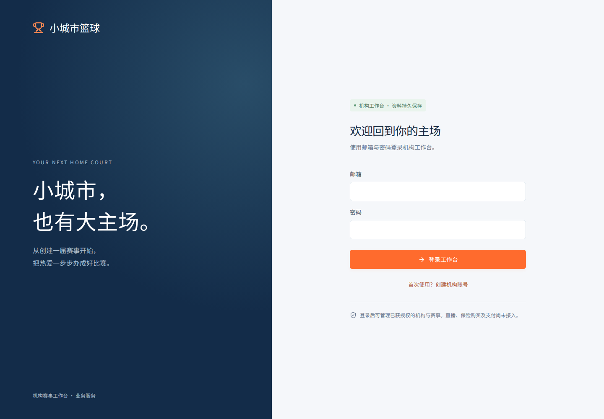
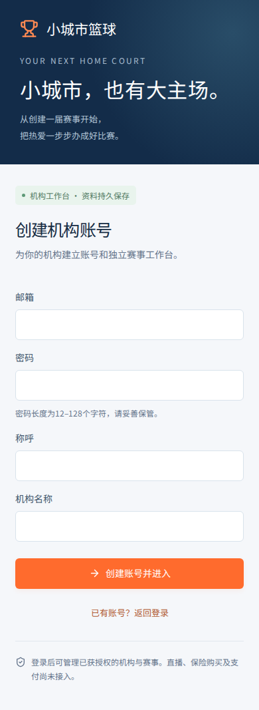

# P02 验证证据

更新：2026-10-22（Asia/Shanghai）。**DONE / MAIN**，PR#2整合29c4ee4；未上线生产。

## 最终远端结果

[PR#2](https://github.com/xyq-dev/small-city-basketball/pull/2)；[Application checks39730670229](https://github.com/xyq-dev/small-city-basketball/actions/runs/39730670229)，head63b94be，admin/api两个job全部成功。

- 安装、格式、类型、71项单元/组件/HTTP检查及两端构建通过。
- 20项独立真实PostgreSQL集成场景通过；集成命令额外匹配20项源码单测，因此日志40不能重复计数。
- 实际PostgreSQL18.6重启后，原会话、赛事、版本、授权、审计历史及迁移校验和保留，表内容指纹一致。Migration001已在隔离测试库执行并验证重复运行。
- 官方Chromium151：12项Mock回归与4项真实API桌面/手机浏览器全部通过。真实流程覆盖注册、创建、刷新、编辑、退出/登录、两机构切换，以及故障时不回退Mock。

首轮39730422963的API浏览器在服务启动时失败，尚未执行4项业务场景；指定workspace端口命令修复后，以上最终运行通过。失败及本地数据库限制保留在[P02交接](../../handoffs/P02.md)。没有生产Migration、生产部署或OBS连接验证。

## 视觉证据

登录/注册页1440与390宽度无横向溢出或运行错误，输入字号16px。这些是隔离未登录截图，session读取拦截为401，仅用于视觉核验；真实认证结果由上面的CI证明。容器缺中文字形，QA页临时注入本地Noto Sans SC；产品仍使用系统字体，无外部字体依赖。

手机为Chromium尺寸/输入模拟，尚未做Safari/真机验证。
