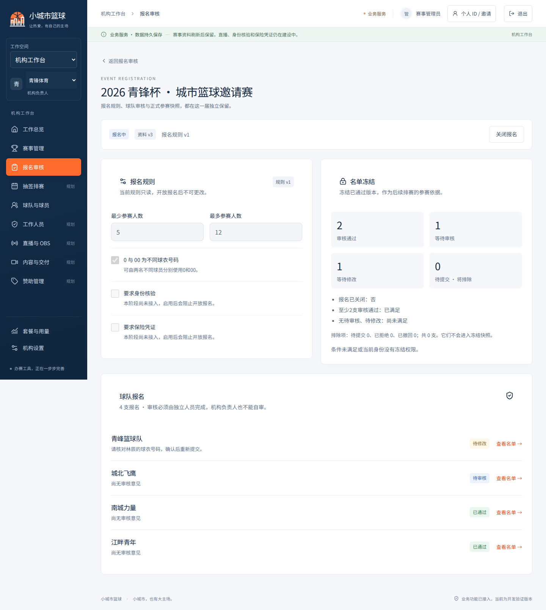
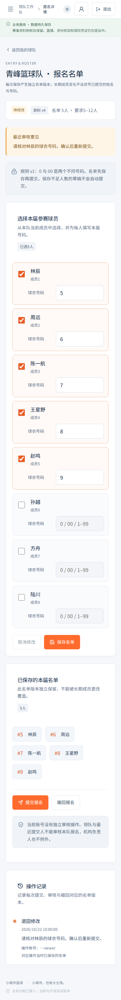

# P03-A 验证证据

更新2026-10-22 Asia/Shanghai；本地已整合，尚未完成真实PG或官方浏览器验收，不能视为main完成或生产上线。

根集成后npm ci（264包）、格式、完整strict typecheck（含浏览器测试/配置）、97项单元/组件/HTTP检查（admin72+api25）、两端build均通过。最终界面修复后再次完成相应admin检查、Runtime14项及admin构建；API内容不变。23项新增PG与原20项PG测试已编写，真实执行待CI；6项API与12项Mock浏览器场景待本次远端运行。

## 视觉检查

机构报名工作台及领队名单在1440/390宽度检查，无页面异常、横向溢出、卡片内输入框越界或按钮文字裁切；表单输入16px。修正了手机号码输入框伸出卡片、账号按钮文字被挤压及报名子页导航高亮。QA浏览器为仓库外Chromium153；这不是正式浏览器/数据库验收。

下面截图使用隔离合成HTTP fixture，只检查界面；没有真实人员资料，也不证明真实注册、提交或冻结成功。QA页为容器中文字形临时注入本地Noto Sans SC，产品仍用系统字体，不新增字体服务。真实业务结果后续以CI和[P03-A交接](../../handoffs/P03-A.md)为准。

