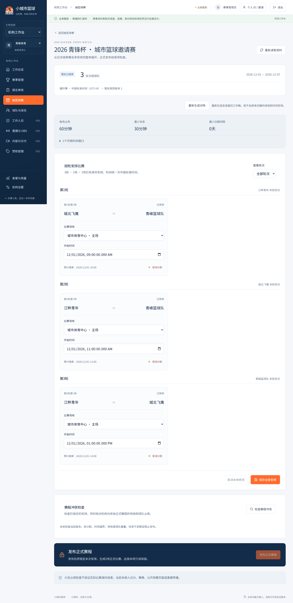
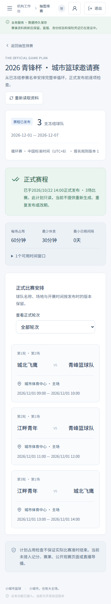

# P04-A验证证据

2026-10-22 Asia/Shanghai，**DONE / MAIN**。[PR4](https://github.com/xyq-dev/small-city-basketball/pull/4)代码7336bfa已合并9fc9b3019eeef52d5b7a66643b01f0fe993af09f。

[CI39737812114](https://github.com/xyq-dev/small-city-basketball/actions/runs/39737812114)首轮全部成功：158项（admin89+api69）、68项独立真实PG（20+24+24）、实际PG18.6重启、12Mock及8API官方Chromium151.0.7922.34桌面/手机浏览器，格式/完整类型及两端build。001–003隔离库已执行复跑校验；没有生产执行或部署。手机为Chromium模拟，未验Safari/微信真机。

实际数据库验证canonical资源跨赛事冲突、可观察锁竞争、先检查后抢占、审计回滚、不可变发布及重启持久化；真实UI完成建Court、生成、冲突/修正、校验和一次发布重载。独立静态审查CLEAR，自动CodeReview completed无finding，自动security review未运行。详情、hash及恢复点见[交接](../../handoffs/P04-A.md)。

## 视觉检查

草稿和正式赛程1440/390无pageerror、页面横向溢出、卡片控件越界或按钮裁切；手机input/select/textarea全部16px。截图是隔离合成HTTP fixture，仅作布局证据，不能证明数据库或发布成功；真实业务以以上CI为准。

QA使用仓库外Chromium153，临时注入本地Noto Sans SC检查中文字形；产品使用系统字体，不新增字体服务。其他赛制/自动排时/改期、记分、微信、公开观赛及OBS不因这些截图完成。

